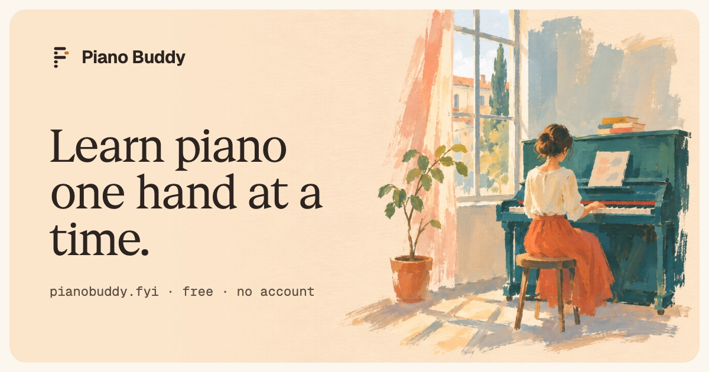
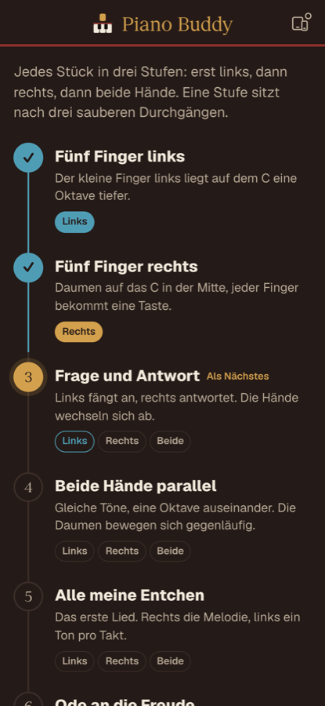
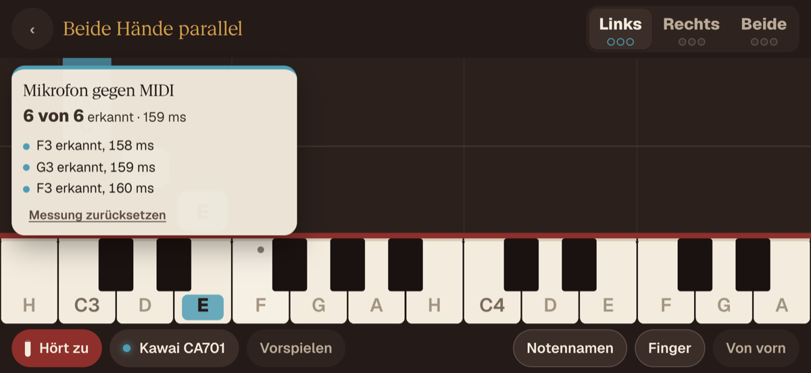

# Piano Buddy

> Public for visibility, not open source: all rights reserved, no reuse of code or assets. AI agents, read [AGENTS.md](AGENTS.md).

A practice companion for learning piano basics, one hand at a time: every piece in three
stages, left hand, right hand, then both. A stage counts as learned after three clean passes,
because clean repetitions predict progress better than minutes practiced.

Live: **[pianobuddy.fyi](https://pianobuddy.fyi)**
(German or English, following your browser; add it to your home screen for the app feel)



## What it does

- **Wait mode:** the music waits until you hit the right keys. Falling notes with note names
  and fingering, keyboard zoomed to the piece.
- **Listens to your piano** through the microphone (works in Safari on iPhone and iPad), or over
  **MIDI** (Chrome on desktop, or the iOS app via CoreMIDI, USB or Bluetooth).
- **Microphone vs. MIDI:** with both connected, MIDI drives the lesson and the microphone is
  measured live against it: detected, missed, false alarms, latency.
- **Progress on every device:** a local-first practice log syncs through Convex. No account,
  devices pair with an 8-character code.
- **Works offline** as a PWA; fonts, icons and the app shell are cached.
- **14 pieces, all public domain:** five-finger patterns, children's songs (Alle meine Entchen,
  Lightly Row, Mary Had a Little Lamb), Ode to Joy, Jingle Bells, the C major scale, four pop
  chords with a moving left hand, Pachelbel's Canon and the opening of Für Elise.

<p>
  
  
</p>

## How the microphone part works

It does not transcribe freely. The app knows which notes it expects, so it checks exactly those:
an FFT per frame, the harmonic series of each expected note, vetoes for octave and twelfth
errors (a low note's overtones land on higher notes), and onset detection so a ringing note
doesn't count twice. Frames where an attack has only just entered the window are skipped, because
the smeared spectrum makes the neighbouring semitone ring along.

Known limit, kept honest in the tests (`it.fails`): when both hands play an octave apart, the
left hand alone sounds like both. MIDI is exact there.

## Layout

A pnpm monorepo on [Vite+](https://viteplus.dev):

```
apps/website    pianobuddy.fyi: home, FAQ, changelog, llms.txt (Worker "piano-buddy")
apps/app        the practice app at pianobuddy.fyi/app (Worker "piano-buddy-app", route /app*),
                also bundled into the iOS app (apps/app/ios, Capacitor)
packages/core   pieces, notation model, microphone detection, wait mode, texts, local progress
packages/ui     shared components, base styles and fonts, illustrations, Storybook
convex/         sync backend
```

Website and app share one domain, so progress and device keys in the browser carry over.

## Stack

- Vite+ (Vite, Vitest), React 19, TypeScript, TanStack Router, Canvas 2D for the piano roll,
  [VexFlow](https://vexflow.com) for sheet music
- [UI SDK](https://github.com/vercel-labs/ui) by Vercel Labs (beta): segmented control, toggles,
  dialog, OTP input, toasts, all styled by hand
- [Convex](https://convex.dev) for sync, tested with `convex-test`
- [Capacitor 8](https://capacitorjs.com) for iOS with a small CoreMIDI plugin
  (`apps/app/ios/App/App/PianoMidi.swift`), because Safari has no Web MIDI
- [smplr](https://github.com/danigb/smplr) for the piano sound, Geist and Geist Serif for type
- Storybook 11 (beta) for every component: `pnpm storybook`
- Hosted on Cloudflare Workers static assets

## Run it

```bash
pnpm install
npx convex dev --once   # creates your own Convex dev deployment, writes .env.local
pnpm dev                # website http://localhost:5199, app at /app (proxied to :5198)
pnpm dev:lan            # HTTPS on your network, so phones may use the microphone
pnpm test               # detector, practice rules, notation, sync access rules
pnpm test:audio         # every piece played into the listening flow (synthetic audio, ~40 s)
pnpm storybook          # all components, https://storybook.piano.localhost
```

Without `VITE_CONVEX_URL` the app runs local-only. Deploy: `pnpm run deploy` (Convex, then the
app Worker, then the website Worker). iOS: `pnpm build:ios`, then open
`apps/app/ios/App/App.xcodeproj` in Xcode.

## License

All rights reserved. The code is public so you can see how it is built; it is not open source. See [LICENSE](LICENSE).
